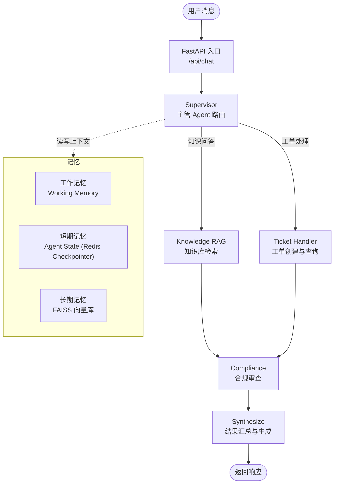

# 商城接入 LangGraph 多 Agent 客服：服务搭建与问题修复

## 前言

mall 是 Spring Boot + Vue 的商城项目。智能客服做成独立的 Python 服务 `mall-customer`，用 LangChain + LangGraph 编排多个 Agent，FastAPI 提供 HTTP 与 SSE 接口。

本篇记录服务本体的搭建：选型、架构、启动，以及启动过程中改动过的两处代码。接入商城（Java 侧转发、会话落库、前端悬浮窗）放在下一篇。

## 一、选型

服务基于开源项目 [smart-cs-multi-agent](https://github.com/bcefghj/smart-cs-multi-agent) 的 Python 版本改造，原因有三点：

- 已经是可运行的多 Agent 项目：由 Supervisor 节点统一调度子 Agent，编排骨架不用自己搭；
- 提供 Java、Go、Python 多语言实现，便于对照阅读；
- 代码结构清晰，适合二次开发。

## 二、架构

用户消息先进 FastAPI 的 `/api/chat`，由 Supervisor 判断意图并路由；子 Agent 的处理结果经合规审查后汇总成回复：



除编排层外，服务还有三块内容：

- **记忆**：工作记忆保存会话内的临时上下文；短期记忆是 LangGraph 的 Agent State，由 `AsyncRedisSaver` 持久化到 Redis，TTL 30 分钟；长期记忆用 FAISS 向量库。
- **MCP 工具服务**：`mcp/mcp_server.py` 统一提供工具的发现与调用。
- **链路追踪**：`tracing/otel_config.py`，通过 OpenTelemetry 的 OTLP 上报，默认 `localhost:4317`。

目录结构：

```text
mall-customer/
├── agents/                 # 智能体层
│   ├── supervisor.py       # Supervisor 编排 Agent
│   ├── intent_router.py    # 意图识别
│   ├── knowledge_rag.py    # 知识库 RAG 问答
│   ├── ticket_handler.py   # 工单处理
│   └── compliance_checker.py  # 合规审查
├── api/
│   └── main.py             # FastAPI 入口（REST + SSE）
├── memory/                 # 记忆层
│   ├── working_memory.py   # 工作记忆
│   └── long_term.py        # 长期记忆 (FAISS)
├── mcp/                    # MCP 工具服务
│   └── mcp_server.py
├── tracing/
│   └── otel_config.py      # OpenTelemetry 链路追踪
└── requirements.txt
```

## 三、启动

把原项目的 Python 版本拷贝进商城仓库、重命名为 `mall-customer` 后启动：

```bash
cd mall-customer
pip install -r requirements.txt
cp .env.example .env    # 至少填写 OPENAI_API_KEY、OPENAI_BASE_URL
python -m api.main
```

服务启动后，`http://localhost:8000/docs` 是 FastAPI 自动生成的接口文档，包含对话（`/api/chat`）、历史记录、工具列表与调用、监控指标、健康检查几组接口：


## 四、问题与修改

启动和调试过程中改了两处代码。

### 问题一：模型名硬编码

`supervisor.py` 里指定的默认模型是 `gpt-4o`，与环境变量中配置的模型不一致时报错。问题出在这段硬编码——不读环境变量，直接用固定值：

```python
if llm is None:
    llm = ChatOpenAI(model="gpt-4o", temperature=0)
```

改为从环境变量读取，之后切换模型只需改 `.env`：

```python
if llm is None:
    llm = ChatOpenAI(model=os.getenv("MODEL_NAME"),
                     api_key=os.getenv("OPENAI_API_KEY"),
                     base_url=os.getenv("OPENAI_BASE_URL"),
                     temperature=0)
```

### 问题二：汇总回复时类型不匹配

对 `/api/chat` 发送"我要退款"：

```bash
curl -X POST http://localhost:8000/api/chat \
  -H "Content-Type: application/json" \
  -d '{"message": "我要退款", "user_id": "123", "session_id": "12"}'
```

接口报错：

```json
{
  "detail": "处理失败: sequence item 1: expected str instance, dict found"
}
```

原因在汇总环节：合成节点用 `join` 拼接各子 Agent 的结果，而 `join` 只接受字符串。断点处可见，`sub_results` 里 `ticket_handler` 返回的是字符串（`{str}`），`compliance` 返回的是含审核状态的字典（`{dict: 3}`）：


```python
for agent_name, result in sub_results.items():
    if result:
        result_parts.append(result)
final_response = "\n\n".join(result_parts) if result_parts else "抱歉，暂时无法处理您的请求，请稍后重试。"
```

合规审查的结果本身也不该返回给用户：它只判断内容能不能发，把审查细节返回出去，等于把绕过检测的方法一并说了。

因此汇总时跳过 `compliance`：

```python
for agent_name, result in sub_results.items():
    if agent_name == "compliance":
        continue
    if result:
        result_parts.append(result)
final_response = "\n\n".join(result_parts) if result_parts else "抱歉，暂时无法处理您的请求，请稍后重试。"
```

## 五、验证

改完再测，接口正常返回：

```json
{
  "response": "工单已创建成功！\n\n📋 工单号: TK-20261001-9A3855\n📝 类型: refund\n⚡ 优先级: 中等\n📄 摘要: 用户申请退款\n🕐 创建时间: 2026-10-01T22:47:42.764025\n\n我们将尽快处理您的请求，请保存好工单号以便后续查询。",
  "session_id": "12",
  "intent": "ticket_handler",
  "compliance_passed": true
}
```

"我要退款"被路由到 `ticket_handler`（工单处理 Agent），并创建了退款工单。

## 后续计划

- **工单持久化**：建工单表，把工单数据落库；
- **前端集成**：在商城页面加入客服聊天入口；
- **知识库对接**：把商城的 FAQ、商品政策等业务数据接入 RAG 知识库。

## 相关链接

- **商城项目主仓库**：<https://github.com/quuuuj/mall>
- **在线体验**：<https://mall.qiujie.net.cn/>（默认体验账号：`admin` / `123456`）
- **参考开源项目**：<https://github.com/bcefghj/smart-cs-multi-agent>
