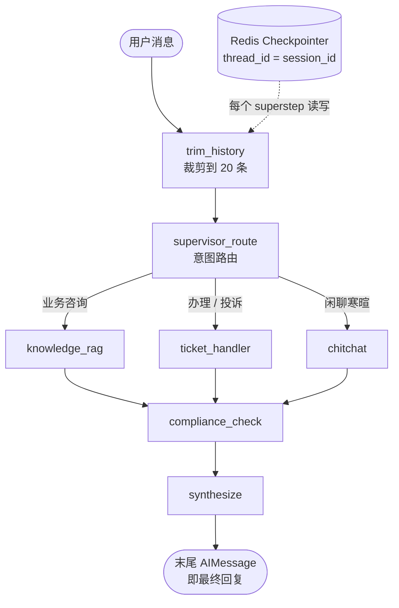
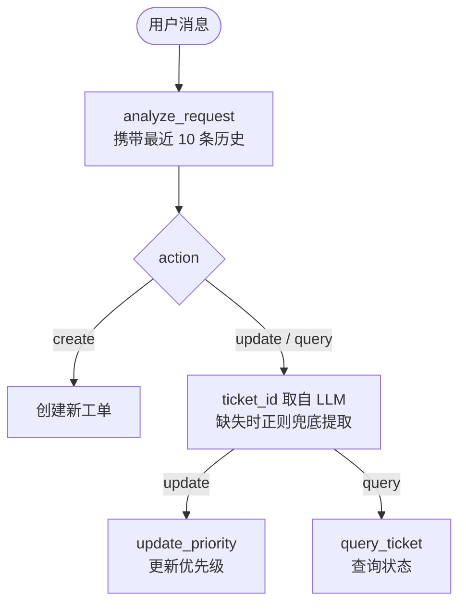

# 智能客服的会话状态改造：Redis Checkpointer 与多轮工单

## 前言

上一篇《智能客服接入商城：调用链、会话表与前端悬浮窗》的后续计划里，多轮上下文一项写着"Redis 短期记忆已经在写入，但还没注入图的状态"。

本篇记录这项改造：短期记忆改为 LangGraph 的 checkpointer，并处理改造后暴露的多轮工单问题。

## 一、旧短期记忆的问题

旧实现 `memory/short_term.py` 是手写的 Redis 封装：消息按会话 ID 存进 Redis list，读取时取最近 N 条。

```python
async def add_message(self, session_id: str, role: str, content: str) -> None:
    message = {"role": role, "content": content, "timestamp": datetime.now().isoformat()}
    key = f"smartcs:short_term:{session_id}"
    await r.rpush(key, json.dumps(message, ensure_ascii=False))  # 追加一条消息
    await r.ltrim(key, -self.max_turns, -1)                      # 只保留最近 20 条
    await r.expire(key, self.ttl_seconds)                        # 30 分钟过期
```

Redis 里存着最近的对话，但它和图是断开的：

- **存了没用上**：`/api/chat` 里 `graph.ainvoke()` 的初始 state 只带本轮这一条新消息，Redis 里的历史没有注入；
- **两套状态各自维护**：`intent`、`compliance_passed` 等编排状态只在图内，既不落 Redis 也不进下一轮，重启即丢失。

## 二、Checkpointer 的读写方式

`graph.compile(checkpointer=...)` 之后，每次执行都以 `thread_id` 为键，把每个 superstep 后的完整状态快照写入存储；下一轮用同一个 `thread_id` 调 `ainvoke()` 时，框架先恢复上次状态、再按字段上的 reducer（`messages` 上是 `add_messages`）合并本轮输入，`graph.aget_state()` 可读出当前状态。


## 三、换成 Redis Checkpointer

- `requirements.txt` 增加 `langgraph-checkpoint-redis>=0.5.0`（本次用 0.5.2）；它用 RedisJSON 存状态、RediSearch 建索引，需要 Redis Stack 或 Redis 8+，本地 compose 的镜像已满足；
- `REDIS_URL` 补上密码。

初始化在 `ShortTermMemory.setup()`：

```python
# Agent State 检查点：TTL 30 分钟（读取/写入均刷新过期时间）
CHECKPOINT_TTL = {"default_ttl": 30, "refresh_on_read": True}


class ShortTermMemory:
    async def setup(self) -> None:
        """初始化 checkpointer：优先 Redis，失败降级进程内 MemorySaver"""
        stack = AsyncExitStack()
        try:
            checkpointer = await stack.enter_async_context(
                AsyncRedisSaver.from_conn_string(self._redis_url, ttl=CHECKPOINT_TTL)
            )
            await checkpointer.asetup()
            self._stack, self._checkpointer = stack, checkpointer
        except Exception as e:
            print(f"[ShortTermMemory] Redis checkpointer 初始化失败，降级为内存 MemorySaver: {e}")
            await stack.aclose()
            self._stack, self._checkpointer = None, MemorySaver()
```

- `default_ttl` 单位是分钟，`refresh_on_read: True` 表示读取时也续期；`asetup()` 建索引与文档结构，启动时执行一次，幂等；
- `from_conn_string()` 是异步上下文管理器，用 `AsyncExitStack` 手动进入：连接失败时资源回滚，降级为进程内的 `MemorySaver`（重启即失效、多进程不共享）。

接线在 `api/main.py` 的 lifespan 里：

```python
await short_term_memory.setup()

graph = create_supervisor_graph(
    working_memory=working_memory,
    long_term_memory=long_term_memory,
    checkpointer=short_term_memory.checkpointer,
)
```

参数从短期记忆对象改为 `checkpointer`，图不再依赖具体的存储实现：

```python
if checkpointer is None and enable_checkpointing:
    checkpointer = MemorySaver()
compiled = graph.compile(checkpointer=checkpointer)
```

`/api/chat` 把 `session_id` 当作 `thread_id`，初始 state 只放本轮消息与业务字段：

```python
config = {"configurable": {"thread_id": session_id}}
initial_state = {
    "messages": [HumanMessage(content=request.message)],
    "user_id": request.user_id,
    "session_id": session_id,
}
result = await graph.ainvoke(initial_state, config=config)
```

`/api/history` 改为读图的状态快照：

```python
snapshot = await graph.aget_state({"configurable": {"thread_id": session_id}})
messages = (snapshot.values or {}).get("messages", [])
history = [
    {"role": role_map.get(type(msg), "system"), "content": msg.text}
    for msg in messages
]
return history[-last_n:]
```

TTL 只管会话过期，不管消息条数。条数由新增的入口节点 `trim_history` 控制，它排在本轮输入合并之后执行，用 `RemoveMessage` 移除超出 20 条窗口的最旧消息：

```python
# 短期记忆滑动窗口：Agent State 中最多保留最近 20 条消息（约 10 轮对话）
MESSAGE_WINDOW_SIZE = 20


def trim_history(state: AgentState) -> dict[str, Any]:
    """滑动窗口：把 Agent State 的消息裁剪到最近 MESSAGE_WINDOW_SIZE 条"""
    messages = state.get("messages", [])
    overflow = len(messages) - MESSAGE_WINDOW_SIZE
    if overflow <= 0:
        return {}

    removals = [RemoveMessage(id=m.id) for m in messages[:overflow] if m.id]
    return {"messages": removals}
```

```python
graph.add_node("trim_history", trim_history)
graph.set_entry_point("trim_history")
graph.add_edge("trim_history", "supervisor_route")
```

与旧实现的 `ltrim` 不同：`RemoveMessage` 只是向状态提交一次删除指令，由 `add_messages` reducer 处理，与合规撤回是同一套机制。

## 四、状态模型调整

`AgentState` 去掉了 `sub_results`（各子 Agent 结果按名字分桶）和 `final_response`（合成节点拼好的回复）——前者不是消息，不会恢复成上下文；后者与末尾的 AIMessage 内容相同，存了两遍。

改造后子 Agent 的结果直接作为 `AIMessage` 写入 `messages`，既是要给用户的回复，也是下一轮的对话历史：

```python
return {
    **state,
    "messages": [AIMessage(content=result)],
}
```

合成节点不再拼接，末尾的 `AIMessage` 就是最终回复。改造中还处理了两处边界情况，都来自实际运行：

- **合规不通过时，撤回子 Agent 的结果**：违规内容已写入 `messages`，只追加转人工话术的话，下一轮它仍会作为上下文送入模型，因此要用 `RemoveMessage` 按 id 移除：

```python
if not state.get("compliance_passed", True):
    updates: list[BaseMessage] = []
    if isinstance(last, AIMessage) and last.id:
        updates.append(RemoveMessage(id=last.id))   # 撤回子 Agent 的结果
    updates.append(AIMessage(content=final_response))
    return {**state, "messages": updates}
```

- **合规通过时，不再追加第二份回复**：合成节点最初无条件追加 `final_response`，历史里因此出现两条相同的 AI 消息，改为先判断末尾是否已有回复：

```python
if isinstance(last, AIMessage) and bool(last.content):
    return state   # 子 Agent 已写入回复，直接收尾
```

合规审查对象也从 `sub_results` 拼接串改为 `messages` 末尾的 `AIMessage`。

改造后的图：



## 五、多轮工单

改造完成后，多轮场景仍有问题：依次发送退款申请、"太慢了，给它升级为紧急优先级"、"查一下它的进度"，三条消息建了三张工单。

原因在 `ticket_handler`：分析请求时只把最后一条消息交给 LLM，历史从未传入。

```python
last_message = messages[-1].content
ticket_info = await self.analyze_request(last_message)   # 历史从未传入
```

修复分两层：

- **分析时带上历史**：取最近 10 条对话格式化成文本，与当前消息一起交给 LLM；

```python
history_text = self._format_history(messages[:-1])
ticket_info = await self.analyze_request(last_message, history_text)
```

同时在系统 prompt 里写死规则：指代、查询、更新**已有**工单的消息（"那个工单""它"等），`action` 必须是 `query` 或 `update`，工单号从历史里提取，严禁新建工单。

- **正则兜底**：LLM 可能漏带 `ticket_id`，从历史消息由新到旧扫描，用正则取最近出现过的工单号：

```python
TICKET_RE = re.compile(r"TK-\d{8}-[A-Fa-f0-9]{6}")
ticket_id = ticket_info.get("ticket_id") or self._extract_ticket_id(messages)
```

判定逻辑：



## 六、chitchat 节点

用户只发一句"你好"也会被路由到 `knowledge_rag`，多出一次无意义的知识库检索。为此加了 `chitchat` 节点，专门处理打招呼、感谢、告别这类消息，不检索知识库，行为约束写在系统 prompt 里：

```python
CHITCHAT_SYSTEM_PROMPT = """你是一个友好的电商客服，负责处理用户的寒暄与闲聊。
...
回答规则：
1. 简短友好，符合客服场景，不超过3句话
2. 不检索、不编造任何业务信息（商品价格、订单状态等一律不回答）
3. 不做任何业务承诺（退款、赔付、优惠等）
4. 用户若提及具体业务问题，礼貌引导其重新描述，由知识库回答
"""
```

改动三处：路由 prompt 增加 `chitchat` 选项；图上注册节点并汇聚到合规检查；`route_map` 增加映射。

## 七、验证

验证在本地 docker compose 的中间件（含 `redis-stack-server`）上进行，直接调用 `mall-customer` 的接口，不经过 Java 后端。以下为实际结果。

- **多轮上下文**：两轮对话为"我叫小明，记住我的名字"→"我叫什么名字？"，第二轮正确回溯了第一轮的姓名，`/api/history` 返回的 4 条消息与对话一致。


- **重启恢复**：重启 `mall-customer` 进程后，`/api/history` 仍返回完整的 4 条消息；追问姓名时，回复正确引用了重启前告知的信息。


- **多轮工单**：修复前三条消息建了三张工单；修复后第一条建单 `TK-20261011-6C4751`（中等优先级），第二条返回"工单已更新成功！工单号: TK-20261011-6C4751 ⚡ 优先级: 紧急"，第三条查回同一张单，更新时间正是升级优先级的时间。


- **合规撤回与去重**：这两条路径不便直接演示，用 `FakeListChatModel` 写临时冒烟脚本按图的三条出口断言，全部通过：合规通过只留一条 AI 回复；不通过时违规结果被 `RemoveMessage` 撤回，只留转人工话术；直达合规时追加兜底话术。

- **Redis 中的键与消息窗口**：一个会话对应 `checkpoint:`、`checkpoint_latest:`、`checkpoint_write:`、`write_keys_zset:` 四类键，TTL 30 分钟并随读写刷新；15 轮对话后消息数稳定在 20 条，写入 22 条再触发一轮时最早的 2 条被移除。

- **降级路径**：`REDIS_URL` 指向不存在的端口时，服务打印降级日志后正常启动，checkpointer 类型变为 `InMemorySaver`。

```text
[ShortTermMemory] Redis checkpointer 初始化失败，降级为内存 MemorySaver: ...
Redis 不可用时 => InMemorySaver
Redis 可用时   => AsyncRedisSaver
```

## 小结

- 短期记忆交给 `AsyncRedisSaver`：以 `thread_id` 为键持久化整份会话状态，TTL 30 分钟，入口节点 `trim_history` 把消息裁到最近 20 条，Redis 不可用时降级进程内存储；
- `AgentState` 只保留 `messages` 一条主线：子 Agent 的结果直接写入消息，合规撤回用 `RemoveMessage`，合成节点不再重复追加；
- 工单 Agent 分析请求时带上最近 10 条对话，并用正则从历史里兜底提取工单号。

上一篇后续计划里的多轮上下文已完成；工单持久化（仍是内存存储）、业务数据接入、Markdown 渲染还在后面。

## 相关链接

- **项目地址**：<https://github.com/quuuuj/mall>
- **在线访问**：<https://mall.qiujie.net.cn/>（默认体验账号：`admin` / `123456`）
